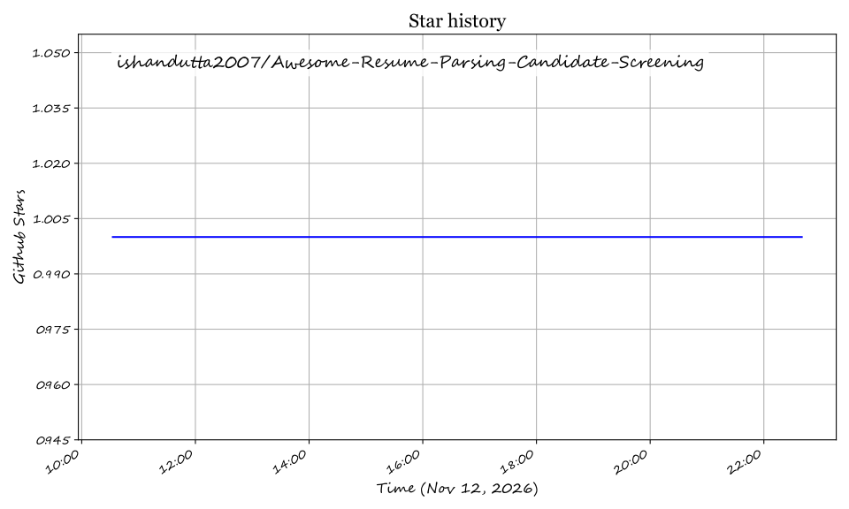

# 📄 Awesome Resume Parsing & Candidate Screening 🎯

  
  
  
  
  
  
  

> 🌟 A curated directory of top-tier **Resume Parsing** and **Candidate Screening** engines — bridging high-performance open-source layout parsers, deep LLM extractors, and enterprise SaaS APIs for automating recruitment workflows, parsing CVs, and ranking applicants with precision. 🚀

---

## 📋 Table of Contents

- [🌐 Sector Overview & Market Dynamics](#-sector-overview--market-dynamics)
- [🏢 SaaS / Hosted Platforms](#-saas--hosted-platforms)
  - [Textkernel](#textkernel)
  - [Affinda](#affinda)
  - [Daxtra](#daxtra)
  - [RChilli](#rchilli)
  - [Sovren (Talenteca)](#sovren-now-part-of-talenteca)
  - [HireAbility](#hireability)
- [💻 Open-Source Software](#-open-source-software)
  - [Resume-Matcher](#resume-matcher)
  - [open-resume](#open-resume)
  - [JadeAI](#jadeai)
  - [pyresparser](#pyresparser)
  - [AI-Resume-Analyzer](#ai-resume-analyzer)
  - [OpenCATS](#opencats)
  - [Entity-Recognition-In-Resumes-SpaCy](#entity-recognition-in-resumes-spacy)
  - [SmartResume (Alibaba)](#smartresume-alibaba)
  - [ResumeParser](#resumeparser)
  - [nlp-resume-parser](#nlp-resume-parser)
  - [ats-screener](#ats-screener)
  - [resume-parser](#resume-parser)
  - [ats-buddy](#ats-buddy)
  - [SmartHire](#smarthire)
  - [CandiSift](#candisift)
  - [resume-parser-ats](#resume-parser-ats)
  - [Resume Analyzer Agent](#resume-analyzer-agent)
  - [somus/resume-extract](#somusresume-extract)
  - [CVInsight](#cvinsight)
  - [HireFlow](#hireflow)
- [📊 Comparison at a Glance](#-comparison-at-a-glance)
- [📈 Star History](#-star-history)
- [💖 Support & Sponsorship](#-support--sponsorship)
- [🤝 Contributing](#-contributing)
- [📄 License](#-license)

---

## 🌐 Sector Overview & Market Dynamics

The global resume parsing and candidate screening software market is valued at approximately **$350M–$500M** and is projected to surpass **$1.2B by 2032**, expanding at a robust **CAGR of ~11.5%–14.2%** driven by high application volumes and AI hiring automation. The sector exhibits a **concentrated foundational core with a highly fragmented application layer**: a handful of enterprise API providers (such as Bullhorn's Textkernel, Daxtra, and RChilli) dominate deep taxonomy and mission-critical parsing engines, while hundreds of vertical ATS platforms, open-source projects, and LLM-powered wrappers compete fiercely across niche candidate-matching workflows.

---

## 🏢 SaaS / Hosted Platforms

Commercial, cloud-hosted Resume Parsing and Candidate Screening platforms. These are not open-source but represent the leading commercial engines. Sorted descending by estimated company size (valuation / annual revenue).

| Platform | Company Size (Valuation / Revenue) | Starting Price (Specific Tier) | Free Tier / Free Trial Limits | Key Specialization | Deployment |
|:---|:---|:---|:---|:---|:---|
| **[Textkernel](https://www.textkernel.com/)** | **~$330M Valuation** (~$40M ARR; acquired by Bullhorn) | **$99/month** (Starter tier, ~500 parse credits/mo; Accelerator bundles at $200) | **500 free parse/matching credits** (Free developer/eval trial, 30 days) | Enterprise taxonomy-driven normalization & semantic candidate matching in 29+ languages | Cloud API / ATS OEM |
| **[Affinda](https://www.affinda.com/)** | **~$220M Valuation** (~$6M ARR; $25M growth round) | **$0.10/document** (Pay-as-you-go; or $800/year bundle for 6,000 parses) | **14-day free trial** with **200 free parse credits** (no credit card required) | Deep multilingual parsing (50+ languages), AI extraction, and self-hosted container options | Cloud API / Self-Host |
| **[Daxtra](https://www.daxtra.com/)** | **~$15.9M ARR** (~$80M–$100M est. valuation; backed by Strattam Capital) | **$75/user/month** (or ~$0.01/parse enterprise volume contracts; min. annual commitment) | **Custom POC trial** (requires enterprise sales demo; 14 days, up to 500 test parses) | Enterprise parsing, multilingual search & match, and ATS recruitment workflow automation | Cloud API / Hybrid |
| **[RChilli](https://www.rchilli.com/)** | **~$15M ARR** (~$60M–$80M est. valuation) | **$75/month** (Starter Plan for 500 parse credits; scales to $0.02/credit at enterprise) | **100 free parse credits** (Free trial account upon signup, valid 30 days) | API-first resume & job parser with 40+ language support and skills taxonomy normalization | Cloud REST API |
| **[Sovren](https://www.sovren.com/)** *(Textkernel)* | **Subsumed under Textkernel / Bullhorn** (Historically ~$10M–$15M ARR) | **$100/month** (Historically ~$0.05–$0.08 per transaction; now under Textkernel enterprise) | **500 parse test credits** (via Textkernel evaluation trial) | Multi-language semantic matching, parsing, and configurable recruitment heuristics | Cloud API / On-Prem |
| **[HireAbility](https://www.hireability.com/)** | **~$1M–$3M ARR** (Private boutique firm) | **$100/month** (ALEX Parser base subscription tier; or prepaid blocks from $0.05/parse) | **Free integration trial** with **100 free test parses** and sandbox API access | ALEX parser running since 1999 with 50+ languages and HR-XML/JSON standard output | Cloud Web Service |

### Textkernel
**Type:** Enterprise resume parsing with taxonomy-driven normalization  
Textkernel is one of the long-standing enterprise standards for resume parsing, with a deep investment in taxonomy-driven normalization that keeps search results clean over time. It supports 29+ languages and bundles semantic search and matching capabilities alongside parsing. Acquired by Bullhorn for ~€300M, it powers high-volume enterprise recruitment teams.

### Affinda
**Type:** Resume parsing with self-hosting option  
Affinda supports 50+ languages and is notable for offering **self-hosting** containers alongside its cloud API. It bundles semantic search and matching alongside parsing, with usage-based APIs starting at $0.10 per document and pre-paid annual bundles starting at $800 for 6,000 documents.

### Daxtra
**Type:** Resume parsing with semantic search and matching  
Daxtra provides resume parsing with semantic search and matching, supporting multiple languages and offering taxonomy-driven normalization. It is built for recruitment agencies and high-volume corporate staffing, operating primarily through structured annual contracts.

### RChilli
**Type:** API-first resume parsing with broad language support  
RChilli is an API-first resume parser supporting 40+ languages, with taxonomy-driven normalization and semantic search capabilities. It gives developers granular control over extraction with turnkey connectors for Oracle, SAP SuccessFactors, Salesforce, and modern ATS backends.

### Sovren (now part of Talenteca / Textkernel)
**Type:** Resume parsing with multi-language support  
Sovren has invested decades into algorithmic and NLP resume parsing technology. Widely deployed across legacy and modern recruiting stacks, Sovren's parsing and scoring tech now integrates directly into the broader Textkernel suite.

### HireAbility
**Type:** Long-standing US-based resume parsing  
HireAbility's ALEX parser has processed resumes since 1999. Supporting 50+ languages, it is targeted at organizations that prioritize predictable volume pricing and clean HR-XML/JSON schemas.

---

## 💻 Open-Source Software

Self-hosted, community-driven Resume Parsing and Candidate Screening tools. Sorted in descending order by GitHub Stars_Count.

### [Resume-Matcher](https://github.com/srbhr/Resume-Matcher) 
**Stack:** Python / Streamlit / FastAPI / Qdrant / LLM | **License:** Apache-2.0  
Resume-Matcher is an AI harness for parsing resumes, comparing resumes to job descriptions, and optimizing content. It vectorizes candidate profiles, computes semantic similarity using vector embeddings, identifies missing skill keywords, and provides concrete improvement recommendations to pass ATS screening filters.  
**Best for:** Candidates and recruiters wanting local semantic JD-to-resume matching, skill gap visualization, and LLM-assisted resume optimization.

### [open-resume](https://github.com/xitanggg/open-resume) 
**Stack:** TypeScript / Next.js / Tailwind CSS / PDF.js | **License:** MIT  
OpenResume is a modern open-source resume builder and ATS resume parser. It parses uploaded PDF resumes locally in the browser using an innovative 4-step algorithm (text extraction, section grouping, feature scoring, and entity assignment) without transmitting sensitive candidate PII to external servers.  
**Best for:** Developers building client-side resume applications and applicants wanting instant local ATS-readability inspection and profile generation.

### [JadeAI](https://github.com/LingyiChen-AI/JadeAI) 
**Stack:** Python / React / Docker / LLM | **License:** AGPL-3.0  
JadeAI is an AI-powered smart resume builder and candidate screening platform. It features multi-format resume parsing (PDF and scanned images via OCR), JD match analysis, LLM-based content polishing, and multi-format export with one-click Docker deployment.  
**Best for:** Full-stack deployment of an end-to-end resume creation, OCR extraction, and match-scoring workflow.

### [pyresparser](https://github.com/OmkarPathak/pyresparser) 
**Stack:** Python / spaCy / NLTK / pdfminer / docx2txt | **License:** MIT  
pyresparser is a lightweight Python library for extracting key information from resumes and CVs. It extracts candidate names, contact details, college/universities, degrees, skills, and total experience from PDF and DOCX files using spaCy and NLTK language pipelines.  
**Best for:** Python developers looking for a fast, classical NLP library to extract core structured fields into dictionaries without cloud LLM dependencies.

### [AI-Resume-Analyzer](https://github.com/deepakpadhi986/AI-Resume-Analyzer) 
**Stack:** Python / Streamlit / NLTK / spaCy / pdfminer | **License:** Open Source  
AI-Resume-Analyzer extracts candidate details from resumes using NLP, categorizes skills into industry sectors, calculates ATS resume scores, and recommends personalized courses and skill enhancements based on keyword extraction.  
**Best for:** Educational institutions, bootcamp career portals, and career coaches wanting an interactive Streamlit UI for scoring and candidate feedback.

### [OpenCATS](https://github.com/opencats/OpenCATS) 
**Stack:** PHP / MySQL | **License:** GPL-3.0  
OpenCATS is an established open-source Applicant Tracking System (ATS) and recruitment CRM for recruitment agencies and corporate HR teams. It manages candidate pipelines from requisition creation to final placement.  
**Best for:** Staffing firms and recruiting teams wanting a complete self-hosted ATS infrastructure with candidate pipeline tracking.

### [Entity-Recognition-In-Resumes-SpaCy](https://github.com/DataTurks-Engg/Entity-Recognition-In-Resumes-SpaCy) 
**Stack:** Python / spaCy / NER | **License:** MIT  
A curated NER dataset and spaCy model pipeline trained specifically for parsing entity tags in resumes (names, skills, companies, education, designations, and certifications).  
**Best for:** Machine learning engineers looking to train, benchmark, or fine-tune custom entity recognition pipelines on pre-annotated resume corpuses.

### [SmartResume (Alibaba)](https://github.com/alibaba/SmartResume) 
**Stack:** Python / vLLM / OCR / LayoutLM | **License:** Open Source (Apache-2.0 / Compliance Refactored)  
SmartResume is a layout-aware resume parsing system developed by Alibaba. It extracts text via OCR and PDF metadata, reconstructs reading order using layout detection (92.1% mAP@0.5), and uses LLMs to convert messy multi-column documents into structured fields with 93.1% overall extraction accuracy and ~1.22s processing speeds.  
**Best for:** Enterprise teams wanting high-accuracy layout-aware extraction with local vLLM model execution (Qwen-0.6B-resume).

### [ResumeParser](https://github.com/bjherger/ResumeParser) 
**Stack:** Python / pdfminer / regex | **License:** MIT  
A robust Python framework designed to parse batches of resumes, extract contact information, work experience, and check for required qualification terms against custom job criteria.  
**Best for:** Batch resume filtering and qualification keyword verification across large resume directories.

### [nlp-resume-parser](https://github.com/hxu296/nlp-resume-parser) 
**Stack:** Python / NLP / OpenAI GPT / pdfplumber | **License:** MIT  
An NLP and LLM-powered parser that transforms raw PDF and Word resumes into standardized JSON structures, isolating career milestones, educational background, and technical proficiencies.  
**Best for:** Rapid prototype pipelines leveraging OpenAI API completions for reliable JSON-schema extraction.

### [ats-screener](https://github.com/sunnypatell/ats-screener) 
**Stack:** Python / FastAPI / React | **License:** MIT  
A free, open-source resume screener that simulates how 6 major enterprise ATS platforms (Workday, Taleo, iCIMS, Greenhouse, Lever, and SAP SuccessFactors) parse, filter, and score candidate resumes.  
**Best for:** Applicants and hiring consultancies testing whether resumes survive automated corporate ATS filtering algorithms.

### [resume-parser](https://github.com/perminder-klair/resume-parser) 
**Stack:** JavaScript / Node.js / pdf2json | **License:** MIT  
A lightweight Node.js library to parse resumes and CVs into JSON. It handles common file formats and extracts basic contact information, education, experience, and skill tags with zero native binary dependencies.  
**Best for:** Node.js backend developers needing an easy npm package to convert PDF resumes to JSON.

### [ats-buddy](https://github.com/seehiong/ats-buddy) 
**Stack:** TypeScript / Vite / React / WebLLM / Ollama | **License:** MIT  
A private-by-design ATS resume analyzer that runs entirely on client machines via WebLLM (browser WebGPU) or local Ollama. Computes JD match scores, detects missing keywords, and rewrites bullets with zero server data uploads.  
**Best for:** High-privacy local candidate screening running completely within the browser or locally hosted Ollama.

### [SmartHire](https://github.com/akpadia02/SmartHire) 
**Stack:** Python / Flask / spaCy / MongoDB / scikit-learn | **License:** MIT  
A web application automating resume screening and candidate ranking using TF-IDF and BERT cosine similarity matching against target job descriptions, complete with candidate match scorecards.  
**Best for:** Reference implementations of TF-IDF/BERT candidate ranking paired with an applicant and recruiter dashboard.

### [CandiSift](https://github.com/confused-ai/candisift) 
**Stack:** Python / FastAPI / SQLite / Claude / Agno | **License:** MIT  
An open-source AI ATS with LLM screening, JD-to-candidate matching, and **bias-audited ranking**. Features deterministic pre-filters (auth, location, years), PII stripping prior to model evaluation, durable SQLite task queues, and circuit breaker protection.  
**Best for:** Organizations needing privacy-first candidate evaluation with audit trails and anti-bias screening.

### [resume-parser-ats](https://github.com/dhanushk-offl/resume-parser) 
**Stack:** TypeScript / Node.js / MCP Server | **License:** MIT  
A CLI tool, npm package, and Model Context Protocol (MCP) server that deeply parses resumes using the OpenResume 4-step algorithm, evaluates ATS compatibility (A+ to F grades), and returns prioritized improvements for AI agent workflows.  
**Best for:** AI agent integration via MCP (`parse_resume`, `analyze_resume`) and local command-line ATS auditing.

### [Resume Analyzer Agent](https://github.com/harishkotra/resume-analyzer-agent) 
**Stack:** Python / LangExtract / Ollama (gemma3:4b) / Streamlit | **License:** Apache-2.0  
A local, offline resume analysis tool powered by LangExtract and Ollama. Provides span evidence highlights showing source text for extracted data, skill frequency analysis, and JD gap breakdowns via a Streamlit interface.  
**Best for:** Offline candidate inspection requiring color-coded span verification of extracted qualifications.

### [somus/resume-extract](https://github.com/somus/resume-extract) 
**Stack:** TypeScript / ONNX (DistilBERT) / Kreuzberg | **License:** MIT  
A fast, fully local resume extraction library using a fine-tuned DistilBERT NER model exported to ONNX. Processes documents in ~15ms per resume without API calls, extracting 11+ structured candidate fields.  
**Best for:** High-throughput microservices requiring microsecond-scale offline NER extraction.

### [CVInsight](https://github.com/ReallyNotbaka/CVinsight) 
**Stack:** Python / Google Gemini API | **License:** MIT  
A Python library and CLI tool that parses and extracts structured fields from resumes using Gemini models, offering dedicated extraction functions for experience, education, skills, and summary blocks.  
**Best for:** Developers looking for a straightforward Python client wrapping Gemini's multimodal extraction capabilities.

### [HireFlow](https://github.com/Karthick-cyber-lab/HireFlow) 
**Stack:** Django REST / React / PostgreSQL / scikit-learn | **License:** MIT  
A full-stack recruitment web platform featuring explainable candidate-matching scores, resume uploading, pipeline progression tracking, and Docker Compose deployment.  
**Best for:** Full-stack Django/React recruitment application deployments with transparent matching explanations.

---

## 📊 Comparison at a Glance

| Software | Stars_Count | License | Stack | Local/Offline | Semantic Matching | Best For |
|:---|:---|:---|:---|:---|:---|:---|
| **Resume-Matcher** | 29,260+ ⭐ | Apache-2.0 | Python / Vector DB / LLM | ✅ 100% Local | ✅ Vector-based | ATS optimization & JD matching |
| **open-resume** | 8,970+ ⭐ | MIT | TypeScript / Next.js / PDF.js | ✅ Client-side | ❌ (Scoring) | Browser-based parsing & builder |
| **JadeAI** | 2,010+ ⭐ | AGPL-3.0 | Python / React / Docker | ✅ Self-Host | ✅ LLM-based | Full-stack resume builder & screening |
| **pyresparser** | 950+ ⭐ | MIT | Python / spaCy / NLTK | ✅ 100% Local | ❌ Keyword-based | Lightweight classical NLP extraction |
| **AI-Resume-Analyzer** | 920+ ⭐ | Open Source | Python / Streamlit / spaCy | ✅ Local UI | ❌ Keyword-based | Interactive candidate scoring & courses |
| **OpenCATS** | 780+ ⭐ | GPL-3.0 | PHP / MySQL | ✅ Self-Host | ❌ ATS Pipeline | Full open-source ATS workflow |
| **DataTurks NER** | 460+ ⭐ | MIT | Python / spaCy NER | ✅ 100% Local | ❌ NER only | Custom resume NER training data |
| **SmartResume** | 410+ ⭐ | Open Source | Python / vLLM / LayoutLM | ✅ Local (vLLM) | ❌ Layout parser | Layout-aware enterprise OCR parsing |
| **ResumeParser** | 370+ ⭐ | MIT | Python / pdfminer | ✅ 100% Local | ❌ Rule-based | Batch resume criteria checking |
| **nlp-resume-parser** | 270+ ⭐ | MIT | Python / GPT / NLP | ❌ Cloud LLM | ❌ Parsing only | GPT-powered schema conversion |
| **ats-screener** | 190+ ⭐ | MIT | Python / FastAPI / React | ✅ Local / Self-host | ✅ 6 ATS Simulators | Enterprise ATS scoring simulation |
| **resume-parser (JS)** | 140+ ⭐ | MIT | JavaScript / Node.js | ✅ 100% Local | ❌ Parsing only | Lightweight Node.js JSON extraction |
| **ats-buddy** | 140+ ⭐ | MIT | TypeScript / WebLLM / Ollama | ✅ 100% Local (GPU) | ✅ Vector & LLM | High-privacy local candidate ranking |
| **SmartHire** | 17 ⭐ | MIT | Python / Flask / spaCy | ✅ Local / Self-host | ✅ TF-IDF / BERT | Flask ATS reference implementation |
| **CandiSift** | 6 ⭐ | MIT | Python / FastAPI / Claude | ✅ Local (Stub/LLM) | ✅ Bias-audited | Privacy-first bias-audited ATS |
| **resume-parser-ats** | 5 ⭐ | MIT | TypeScript / Node / MCP | ✅ 100% Local | ❌ ATS grading | MCP AI agent tool & local grading |
| **Resume Analyzer Agent** | 2 ⭐ | Apache-2.0 | Python / LangExtract / Ollama | ✅ 100% Offline | ✅ Gap analysis | Offline span-evidence extraction |
| **somus/resume-extract** | 1 ⭐ | MIT | TypeScript / ONNX (DistilBERT) | ✅ 100% Local | ❌ NER only | Ultra-fast ~15ms NER extraction |
| **CVInsight** | 0 ⭐ | MIT | Python / Gemini LLM | ❌ Cloud Gemini | ❌ Extraction only | Modular Python Gemini parsing |
| **HireFlow** | 0 ⭐ | MIT | Django / React / Postgres | ✅ Docker / Self-host | ✅ Explainable score | Django full-stack ATS platform |

---

## 📈 Star History

---

## 💖 Support & Sponsorship

Thank you for exploring this curated guide to Resume Parsing and Candidate Screening platforms! If this repository has helped streamline your recruitment stack, saved you development time, or introduced you to new open-source tools:

- ⭐ **Star this repository** on GitHub to help others discover it.
- 🍴 **Fork and contribute** tools, libraries, or corrections via a Pull Request.
- 📢 **Share** with colleagues, HR tech teams, and recruitment engineers.
- ☕ **Buy me a coffee / Sponsor:** Support ongoing maintenance and research via the [GitHub Sponsor Dashboard](https://github.com/sponsors/ishandutta2007).

---

## 🤝 Contributing

Contributions are welcome! If you know of an open-source Resume Parsing, ATS Grading, or Candidate Screening project that should be listed here, please open a pull request.

Please follow these guidelines:
- 📌 Include project name, GitHub URL, stack, and active license.
- ⚙️ Ensure the project is maintained and genuinely open-source.
- 💡 Add an objective description highlighting what makes the tool distinct.

---

## 📄 License

This list is released under [Creative Commons Zero v1.0 Universal (CC0-1.0)](https://creativecommons.org/publicdomain/zero/1.0/). Project names and software packages remain copyright of their respective owners.

---

  ⭐ <b>Found this repository valuable for your hiring infrastructure? Star the repo on GitHub!</b> ⭐

## Star History

<a href="https://star-history.com/#ishandutta2007/Awesome-Resume-Parsing-Candidate-Screening&Timeline" align="center">
  <picture>
    <source media="(prefers-color-scheme: dark)" srcset="assets/ishandutta2007_Awesome-Resume-Parsing-Candidate-Screening_growth.svg">
    
  </picture>
</a>
